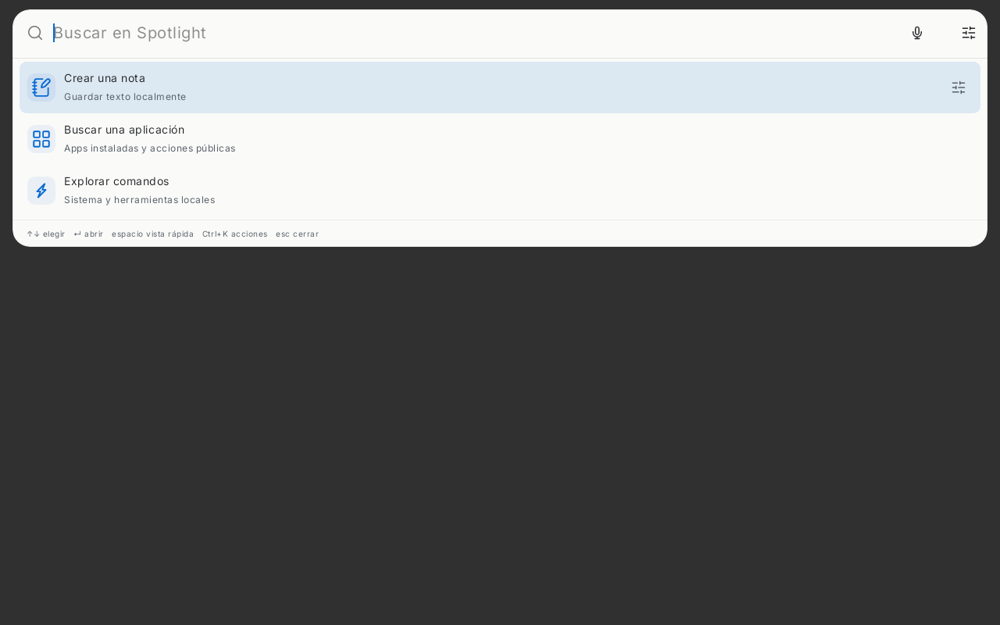
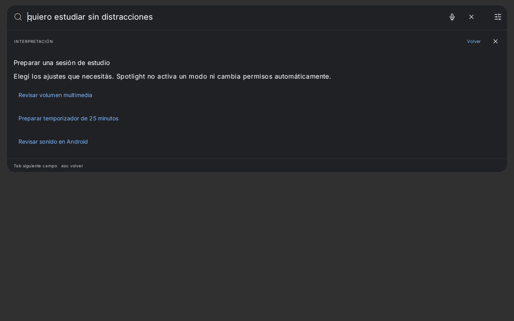
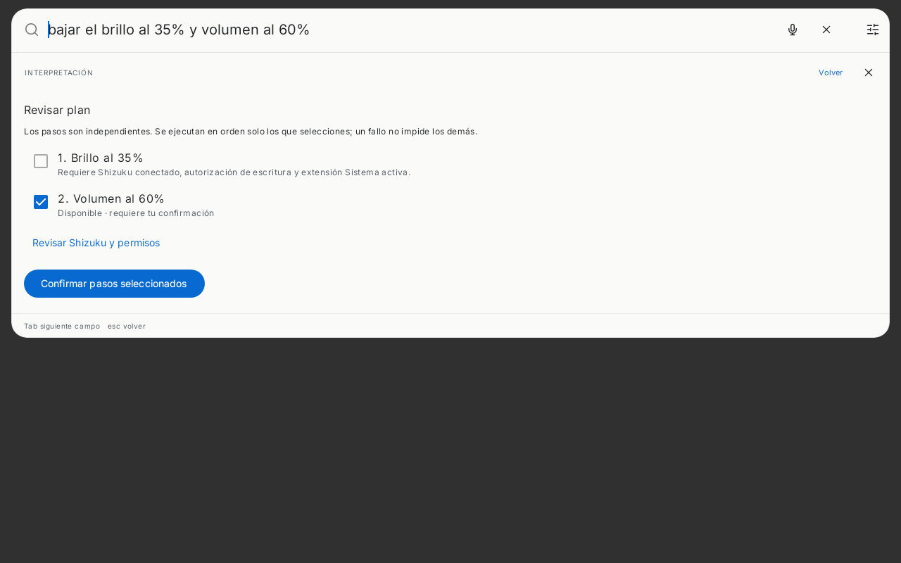
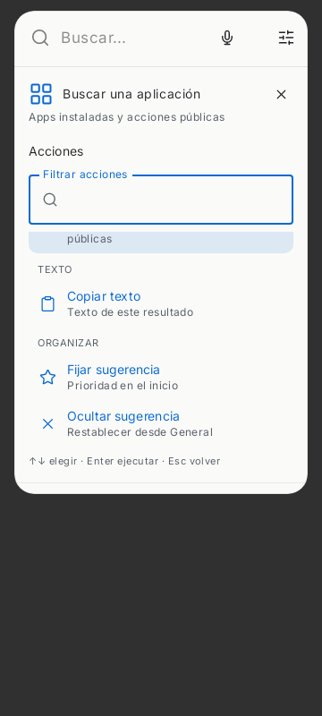

# Spotlight Next 1.3.0 · Hybrid Intelligence

Esta versión conserva el identificador `dev.bautista.spotlight.next` y los almacenes existentes. `versionCode=25` permite superar la versión 1.2.0 instalada (`24`). No se migra ni sobrescribe la apariencia guardada: instalaciones nuevas usan Hybrid/tema automático; instalaciones existentes pueden elegir **Spotlight Hybrid** en Apariencia. El preset conserva acento, texto, densidad y configuración funcional. Los cuatro presets anteriores siguen disponibles.

## Superficie y acciones

La barra y los resultados comparten una superficie opaca con colores perlados o grafito según el tema. El menú Opciones conserva filtros y accesos Ctrl/⌘+1…4; la búsqueda universal no exige usarlos. Las coincidencias de consultas no vacías mantienen el ranking global. Una categoría no puede adelantar todos sus resultados a una coincidencia más relevante de otra. La selección, Tab, Ctrl/⌘+K, pulsación prolongada y operaciones de accesibilidad permiten consultar acciones secundarias. El botón de acciones aparece únicamente en el resultado seleccionado o bajo el puntero. En ventanas estrechas, las acciones ocupan el área de resultados; al cerrar se recuperan lista y selección. Se conservan vistas rápidas, cuadrícula opcional, teclado, permisos y proveedores anteriores.

El inicio ofrece hasta cuatro sugerencias: apps favoritas/recientes realmente instaladas y comandos disponibles, con ocultación y fijación. Los recientes solo se consultan cuando Aprendizaje está activo. Se consulta un máximo de doce paquetes guardados; no se escanean archivos ni se solicitan datos remotos para llenar el inicio.

## Interpretación local

- `escuchar musica`, `quiero escuchar música`, `reproducir música`: aplicaciones musicales instaladas reconocidas por categoría Android o paquetes compatibles; controles de volumen/sesión multimedia existentes. Abrir una app no garantiza comenzar la reproducción.
- `Spotify`, `abrir Spotify`, nombres de contactos, fotos y consultas informativas conservan sus proveedores existentes y permisos. Las acciones públicas de una app dependen de lo que exponga realmente.
- `mandarle un WhatsApp a Juan`: prepara destinatario/borrador en el editor existente; nunca envía automáticamente.
- `bajar el brillo al 35% y abrir Spotify`: plan tipado, local y acotado a seis pasos independientes de brillo, volumen y abrir apps. También acepta `luego` y `después`. Revisa permisos, extensiones y aplicación única coincidente; muestra pasos bloqueados; ejecuta solo pasos seleccionados tras confirmar. Revalida disponibilidad al ejecutar, informa errores por paso y no repite el plan automáticamente. El brillo usa el servicio reversible existente, requiere Shizuku/escritura y respeta el límite 20–255. No habilita brillo menor que ese límite.
- `quiero estudiar sin distracciones`: opciones explícitas para volumen, temporizador y ajustes de sonido Android. No aplica modos arbitrarios.
- `explicame este PDF`: pide elegir un archivo; las acciones existentes permiten extraer texto localmente y revisarlo antes de consultar IA.
- `traducí este texto`, `traducir este texto`, `traduce este texto`: solicita texto explícito y prepara una consulta de traducción con revisión/consentimiento. No lee silenciosamente portapapeles ni documentos. Los transformadores y la traducción local anteriores continúan disponibles.

No se llama a IA al escribir. Las consultas complejas conservan DirectAi y el agente existente; los planes locales reutilizan ToolRegistry/ToolExecutor, su autorización y auditoría. No hay proveedores nuevos ni claves en código.

## APK de actualización

Después de revisar e integrar el PR, ejecutar **Actions → Build Signed Release APK → Run workflow → main**. Solo el repositorio original y esa rama/evento pueden acceder a los cuatro secretos históricos. El workflow compila y prueba antes de decodificar la clave en almacenamiento temporal privado, firma con `apksigner`, verifica alineación, firma válida, único certificado histórico, identificador, APK no depurable, SDK mínimo y `versionCode > 24`. La limpieza elimina el material privado; el artefacto contiene exclusivamente APK y resumen público de verificación.

Descargar `spotlight-next-1.3.0-release-<n>` de Artifacts, extraer `spotlight-next-release.apk` y revisar `update-verification.txt`. El certificado debe ser exactamente `11B0B3B37544BD95B128DE52798FA7FFB7489F94819614B1ADA383BD4EE7A6CF`. El job falla antes de publicar si no coincide. No se generan claves ni se firma en PRs. El Release local se construye sin firma porque los secretos solo existen en Actions; no acredita todavía instalación física ni actualización correcta en Galaxy Tab A9+.

## Verificación

Pruebas de parser/ranking, reconocimiento, resolución de disponibilidad, revisión sin efectos previos a confirmación, ejecución parcial con brillo bloqueado, traducción y contexto faltante, preservación de preferencias, regresiones de teclado/touch, capturas Hybrid clara/oscura y todas las pruebas anteriores. Comprobación completa: `testDebugUnitTest lintDebug assembleDebug assembleRelease`; pruebas Python de backend y verificador de Release. Las capturas Robolectric sirven para comprobar composición, no para afirmar fluidez o compatibilidad física de Samsung. La revisión física debe cubrir overlay sobre apps, IME, TalkBack y Shizuku real.

### Resultado ejecutado

- `:app:testDebugUnitTest`: **240 pruebas, 54 suites, cero fallos, errores u omisiones**. Incluye 19 pruebas nuevas de planes, música, ranking global, privacidad, consentimiento y acciones táctiles; mantiene las 221 anteriores.
- `:app:lintDebug`: **0 errores y 10 advertencias existentes**. Las comprobaciones vitales de Release también pasan.
- `:app:assembleDebug` y `:app:assembleRelease`: **completados**. Release optimizado con R8/reducción de recursos, sin firma local.
- `aapt` sobre el Release real: **applicationId histórico, versionName 1.3.0, versionCode 25 > 24, minSdk 26, no depurable**. El verificador de metadatos pasó. No se ha validado el certificado de este APK local sin firma.
- Firma Debug válida comprobada mediante `apksigner`; su certificado real fue rechazado por el verificador histórico, como corresponde.
- Backend: **5 pruebas aprobadas**. Verificador Release: **10 pruebas aprobadas**.
- Sintaxis Bash, ambos workflows YAML y `git diff --check`: **válidos**.
- Prueba de backend configurado con contador de conexiones: **cero solicitudes mientras se escribe o se revisa el texto antes de confirmar**.
- Teléfono: pulsación prolongada, desplazamiento, ocultación de una sugerencia y persistencia comprobados.

Los planes locales cubren brillo, volumen y apertura de apps únicas; no interpretan cualquier secuencia arbitraria. La traducción contextual nueva solicita texto y lo traduce al español mediante el proveedor de IA configurado. Explicar PDF requiere elección, autorización y extracción explícita del documento. Se conserva la iconografía de contactos existente; no se agregan fotos ni descargas remotas de favicons. No se realizó una prueba física de instalación, Shizuku ni rendimiento en Galaxy Tab A9+.

### Capturas automatizadas

Capturas nativas de Compose generadas por Robolectric; no son capturas de un dispositivo físico.

El rótulo de versión en Ajustes también lee el paquete instalado, reemplazando el texto fijo «1.0». Esta corrección final de presentación se verificó con `compileDebugKotlin` y `compileReleaseKotlin`; ambas compilaciones pasaron después de la verificación completa anterior.
